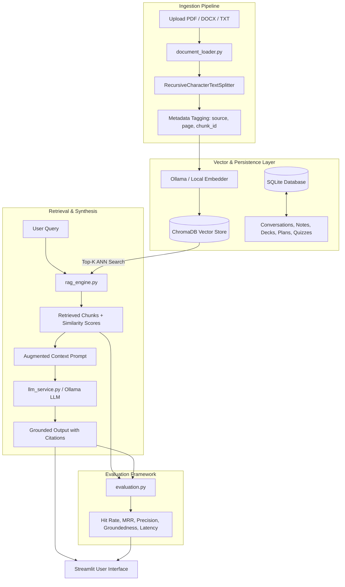

# 🎓 StudySathi: Production-Grade GenAI Study & Interview Assistant

**StudySathi** is a local, privacy-preserving Generative AI study assistant and interview preparation platform built with **Python**, **Streamlit**, **Ollama**, **LangChain**, **ChromaDB**, and **SQLite**. 

It runs 100% locally on your machine with zero paid API keys required by default, while supporting local open-weights foundation models such as **Llama 3.2**, **Mistral**, **Phi-3**, and **Gemma 2**.

---

## 🌟 Key Features

1. **Multi-Format Document Ingestion & Chunking**
   - Parses `.pdf` (via `pypdf`), `.docx` (via `python-docx`), and `.txt` / `.md` notes.
   - Preserves page numbers, source metadata, character counts, and handles boundary splitting using `RecursiveCharacterTextSplitter`.

2. **RAG Chatbot with Inline Source Citations**
   - High-dimensional vector search powered by **ChromaDB** with cosine similarity scoring.
   - Answers are strictly grounded in retrieved passages with clickable/expandable citations: `[Doc N: filename, p.X]`.
   - Complete chat history persistence in local SQLite with 1-click Markdown transcript downloads.

3. **Dual-Mode AI Concept Explainer**
   - **Beginner Mode (ELI5):** Creative real-world analogies, high-level intuition, step-by-step mechanics, and golden takeaways.
   - **Technical Interview Mode:** Deep system architecture, trade-off analysis (latency, memory, throughput), interviewer traps, and model answers.

4. **Multi-Style Smart Summarizer**
   - **Key Takeaways:** Bullet-point core concepts and formulas.
   - **Executive Brief:** High-level problem statement, architecture findings, and recommended next steps.
   - **Exam Cheat Sheet:** Compact markdown tables of definitions, rules, and exam traps.

5. **Active-Recall Interactive Flashcards**
   - Deck management with flip/reveal mechanics, difficulty ratings, and review tracking.
   - AI generation of flashcard decks directly from indexed materials.
   - Mark cards as *Mastered* or *Needs Review*.

6. **Interactive Diagnostic Quiz**
   - Generates multiple-choice questions (A, B, C, D) with custom difficulty levels.
   - Instant scoring, answer reveals, and pedagogical explanations for every option.
   - Saves historical test attempts to SQLite.

7. **Study Planner & Mock Interview Coach**
   - **Roadmap Generator:** Day-by-day milestone schedules tailored to target roles (e.g., GenAI Engineer, ML Engineer).
   - **Mock Interview Simulator:** Dynamic technical interviewer that evaluates candidate responses, provides constructive scores out of 10, and asks progressive follow-up questions.

8. **Quantitative Evaluation & Diagnostics Benchmark**
   - Evaluates **Hit Rate**, **Mean Reciprocal Rank (MRR)**, **Precision@K**, **Groundedness Score** (hallucination detection), and **Latency (ms)** directly from the UI or CLI.

---

## 🏗️ System Architecture & Data Flow



---

## 💻 Windows 11 Step-by-Step Setup Guide

### 1. Prerequisites
- **Operating System:** Windows 10/11 (64-bit)
- **Python:** Python 3.11 (Recommended for maximum ChromaDB and LangChain compatibility)
- **PowerShell:** Default Windows PowerShell or Windows Terminal

### 2. Clone or Navigate to the Project
```powershell
cd E:\Project\study_sathi
```

### 3. Create and Activate Virtual Environment
```powershell
# Using Python 3.11 launcher
py -3.11 -m venv venv

# Activate in PowerShell
.\venv\Scripts\Activate.ps1
```
*(If PowerShell shows an execution policy error, run: `Set-ExecutionPolicy -Scope Process -ExecutionPolicy Bypass`)*

### 4. Install Dependencies
```powershell
python -m pip install --upgrade pip
pip install -r requirements.txt
```

### 5. Configure Environment Variables
Copy `.env.example` to `.env`:
```powershell
Copy-Item .env.example .env
```
Default `.env` settings:
```ini
OLLAMA_BASE_URL=http://localhost:11434
LLM_MODEL=llama3.2
EMBEDDING_MODEL=nomic-embed-text
CHROMA_PERSIST_DIRECTORY=data/chroma_db
SQLITE_DB_PATH=data/studysathi.db
CHUNK_SIZE=800
CHUNK_OVERLAP=150
TOP_K_RESULTS=4
SIMILARITY_THRESHOLD=0.6
DEMO_MODE_FALLBACK=true
```

---

## 🦙 Ollama Local Model Setup (Zero Cost, No API Keys)

StudySathi connects to Ollama running locally on your system.

### 1. Install Ollama for Windows
1. Download the Windows installer from [ollama.com/download](https://ollama.com/download).
2. Run `OllamaSetup.exe` and complete the installation.
3. Start the Ollama server:
   ```powershell
   ollama serve
   ```

### 2. Pull Recommended Models
In a separate PowerShell window, download the lightweight LLM and embedding models:
```powershell
# Foundation LLM (Fast, high-quality, runs on CPU/GPU)
ollama pull llama3.2

# Semantic embedding model
ollama pull nomic-embed-text
```

> 💡 **Demo / Offline Fallback Engine:** If Ollama is not running or a model is still downloading, StudySathi's **Resilient Fallback Engine** automatically activates (`DEMO_MODE_FALLBACK=true`). The app will continue running smoothly with simulated responses, local embeddings, and instant evaluation tests for frictionless demo presentations!

---

## 🚀 Running StudySathi

With your virtual environment activated:
```powershell
streamlit run app.py
```
Streamlit will launch locally at:
👉 **`http://localhost:8501`**

---

## 🧪 Automated Testing & Actual Test Results

StudySathi includes a full test suite built with `pytest` covering all system components:
- `tests/test_database.py`: SQLite schema, chat history, notes CRUD, flashcard mastery, quizzes.
- `tests/test_document_loader.py`: PDF, DOCX, TXT loaders, and text chunking logic.
- `tests/test_rag_engine.py`: Vector embeddings, ChromaDB indexing, and similarity retrieval.
- `tests/test_llm_service.py`: RAG synthesis, concept explanations, flashcards, quiz generator, and interview coach.
- `tests/test_evaluation.py`: Hit Rate, MRR, Groundedness score, and retrieval benchmark suite.

### Run the Test Suite
```powershell
.\venv\Scripts\pytest.exe -v
```

### 📋 Actual Pytest Output
```
============================= test session starts =============================
platform win32 -- Python 3.11.0, pytest-9.1.1, pluggy-1.6.0 -- E:\Project\study_sathi\venv\Scripts\python.exe
cachedir: .pytest_cache
rootdir: E:\Project\study_sathi
configfile: pytest.ini
testpaths: tests
plugins: anyio-4.15.1, langsmith-0.14.8
collected 20 items

tests/test_database.py::test_chat_messages_lifecycle PASSED              [  5%]
tests/test_database.py::test_saved_notes_crud PASSED                     [ 10%]
tests/test_database.py::test_flashcards_lifecycle PASSED                 [ 15%]
tests/test_database.py::test_study_plans_and_quizzes PASSED              [ 20%]
tests/test_document_loader.py::test_extract_text_from_txt PASSED         [ 25%]
tests/test_document_loader.py::test_load_sample_notes PASSED             [ 30%]
tests/test_document_loader.py::test_chunk_documents PASSED               [ 35%]
tests/test_evaluation.py::test_retrieval_metrics PASSED                  [ 40%]
tests/test_evaluation.py::test_groundedness_score PASSED                 [ 45%]
tests/test_evaluation.py::test_answer_relevancy PASSED                   [ 50%]
tests/test_evaluation.py::test_benchmark_runner PASSED                   [ 55%]
tests/test_llm_service.py::test_generate_rag_response PASSED             [ 60%]
tests/test_llm_service.py::test_explain_concept PASSED                   [ 65%]
tests/test_llm_service.py::test_summarize_content PASSED                 [ 70%]
tests/test_llm_service.py::test_generate_flashcards PASSED               [ 75%]
tests/test_llm_service.py::test_generate_quiz PASSED                     [ 80%]
tests/test_llm_service.py::test_generate_study_plan PASSED               [ 85%]
tests/test_llm_service.py::test_mock_interview_turn PASSED               [ 90%]
tests/test_rag_engine.py::test_fallback_embedding PASSED                 [ 95%]
tests/test_rag_engine.py::test_add_and_search_vectorstore PASSED         [100%]

============================= 20 passed in 5.18s ==============================
```

---
