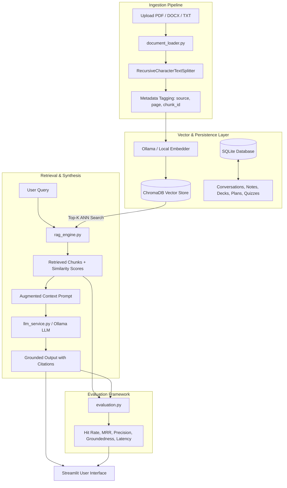

# 🎓 StudySathi: Production-Grade GenAI Study & Interview Assistant

**StudySathi** is a local, privacy-preserving Generative AI study assistant and interview preparation platform built with **Python**, **Streamlit**, **Ollama**, **LangChain**, **ChromaDB**, and **SQLite**. 

It runs 100% locally on your machine with zero paid API keys required by default, while supporting local open-weights foundation models such as **Llama 3.2**, **Mistral**, **Phi-3**, and **Gemma 2**.

---

## 🌟 Key Features

1. **Multi-Format Document Ingestion & Chunking**
   - Parses `.pdf` (via `pypdf`), `.docx` (via `python-docx`), and `.txt` / `.md` notes.
   - Preserves page numbers, source metadata, character counts, and handles boundary splitting using `RecursiveCharacterTextSplitter`.

2. **RAG Chatbot with Inline Source Citations**
   - High-dimensional vector search powered by **ChromaDB** with cosine similarity scoring.
   - Answers are strictly grounded in retrieved passages with clickable/expandable citations: `[Doc N: filename, p.X]`.
   - Complete chat history persistence in local SQLite with 1-click Markdown transcript downloads.

3. **Dual-Mode AI Concept Explainer**
   - **Beginner Mode (ELI5):** Creative real-world analogies, high-level intuition, step-by-step mechanics, and golden takeaways.
   - **Technical Interview Mode:** Deep system architecture, trade-off analysis (latency, memory, throughput), interviewer traps, and model answers.

4. **Multi-Style Smart Summarizer**
   - **Key Takeaways:** Bullet-point core concepts and formulas.
   - **Executive Brief:** High-level problem statement, architecture findings, and recommended next steps.
   - **Exam Cheat Sheet:** Compact markdown tables of definitions, rules, and exam traps.

5. **Active-Recall Interactive Flashcards**
   - Deck management with flip/reveal mechanics, difficulty ratings, and review tracking.
   - AI generation of flashcard decks directly from indexed materials.
   - Mark cards as *Mastered* or *Needs Review*.

6. **Interactive Diagnostic Quiz**
   - Generates multiple-choice questions (A, B, C, D) with custom difficulty levels.
   - Instant scoring, answer reveals, and pedagogical explanations for every option.
   - Saves historical test attempts to SQLite.

7. **Study Planner & Mock Interview Coach**
   - **Roadmap Generator:** Day-by-day milestone schedules tailored to target roles (e.g., GenAI Engineer, ML Engineer).
   - **Mock Interview Simulator:** Dynamic technical interviewer that evaluates candidate responses, provides constructive scores out of 10, and asks progressive follow-up questions.

8. **Quantitative Evaluation & Diagnostics Benchmark**
   - Evaluates **Hit Rate**, **Mean Reciprocal Rank (MRR)**, **Precision@K**, **Groundedness Score** (hallucination detection), and **Latency (ms)** directly from the UI or CLI.

---

## 🏗️ System Architecture & Data Flow



---

## 💻 Windows 11 Step-by-Step Setup Guide

### 1. Prerequisites
- **Operating System:** Windows 10/11 (64-bit)
- **Python:** Python 3.11 (Recommended for maximum ChromaDB and LangChain compatibility)
- **PowerShell:** Default Windows PowerShell or Windows Terminal

### 2. Clone or Navigate to the Project
```powershell
cd E:\Project\study_sathi
```

### 3. Create and Activate Virtual Environment
```powershell
# Using Python 3.11 launcher
py -3.11 -m venv venv

# Activate in PowerShell
.\venv\Scripts\Activate.ps1
```
*(If PowerShell shows an execution policy error, run: `Set-ExecutionPolicy -Scope Process -ExecutionPolicy Bypass`)*

### 4. Install Dependencies
```powershell
python -m pip install --upgrade pip
pip install -r requirements.txt
```

### 5. Configure Environment Variables
Copy `.env.example` to `.env`:
```powershell
Copy-Item .env.example .env
```
Default `.env` settings:
```ini
OLLAMA_BASE_URL=http://localhost:11434
LLM_MODEL=llama3.2
EMBEDDING_MODEL=nomic-embed-text
CHROMA_PERSIST_DIRECTORY=data/chroma_db
SQLITE_DB_PATH=data/studysathi.db
CHUNK_SIZE=800
CHUNK_OVERLAP=150
TOP_K_RESULTS=4
SIMILARITY_THRESHOLD=0.6
DEMO_MODE_FALLBACK=true
```

---

## 🦙 Ollama Local Model Setup (Zero Cost, No API Keys)

StudySathi connects to Ollama running locally on your system.

### 1. Install Ollama for Windows
1. Download the Windows installer from [ollama.com/download](https://ollama.com/download).
2. Run `OllamaSetup.exe` and complete the installation.
3. Start the Ollama server:
   ```powershell
   ollama serve
   ```

### 2. Pull Recommended Models
In a separate PowerShell window, download the lightweight LLM and embedding models:
```powershell
# Foundation LLM (Fast, high-quality, runs on CPU/GPU)
ollama pull llama3.2

# Semantic embedding model
ollama pull nomic-embed-text
```

> 💡 **Demo / Offline Fallback Engine:** If Ollama is not running or a model is still downloading, StudySathi's **Resilient Fallback Engine** automatically activates (`DEMO_MODE_FALLBACK=true`). The app will continue running smoothly with simulated responses, local embeddings, and instant evaluation tests for frictionless demo presentations!

---

## 🚀 Running StudySathi

With your virtual environment activated:
```powershell
streamlit run app.py
```
Streamlit will launch locally at:
👉 **`http://localhost:8501`**

---

## 🧪 Automated Testing & Actual Test Results

StudySathi includes a full test suite built with `pytest` covering all system components:
- `tests/test_database.py`: SQLite schema, chat history, notes CRUD, flashcard mastery, quizzes.
- `tests/test_document_loader.py`: PDF, DOCX, TXT loaders, and text chunking logic.
- `tests/test_rag_engine.py`: Vector embeddings, ChromaDB indexing, and similarity retrieval.
- `tests/test_llm_service.py`: RAG synthesis, concept explanations, flashcards, quiz generator, and interview coach.
- `tests/test_evaluation.py`: Hit Rate, MRR, Groundedness score, and retrieval benchmark suite.

### Run the Test Suite
```powershell
.\venv\Scripts\pytest.exe -v
```

### 📋 Actual Pytest Output
```
============================= test session starts =============================
platform win32 -- Python 3.11.0, pytest-9.1.1, pluggy-1.6.0 -- E:\Project\study_sathi\venv\Scripts\python.exe
cachedir: .pytest_cache
rootdir: E:\Project\study_sathi
configfile: pytest.ini
testpaths: tests
plugins: anyio-4.15.1, langsmith-0.14.8
collected 20 items

tests/test_database.py::test_chat_messages_lifecycle PASSED              [  5%]
tests/test_database.py::test_saved_notes_crud PASSED                     [ 10%]
tests/test_database.py::test_flashcards_lifecycle PASSED                 [ 15%]
tests/test_database.py::test_study_plans_and_quizzes PASSED              [ 20%]
tests/test_document_loader.py::test_extract_text_from_txt PASSED         [ 25%]
tests/test_document_loader.py::test_load_sample_notes PASSED             [ 30%]
tests/test_document_loader.py::test_chunk_documents PASSED               [ 35%]
tests/test_evaluation.py::test_retrieval_metrics PASSED                  [ 40%]
tests/test_evaluation.py::test_groundedness_score PASSED                 [ 45%]
tests/test_evaluation.py::test_answer_relevancy PASSED                   [ 50%]
tests/test_evaluation.py::test_benchmark_runner PASSED                   [ 55%]
tests/test_llm_service.py::test_generate_rag_response PASSED             [ 60%]
tests/test_llm_service.py::test_explain_concept PASSED                   [ 65%]
tests/test_llm_service.py::test_summarize_content PASSED                 [ 70%]
tests/test_llm_service.py::test_generate_flashcards PASSED               [ 75%]
tests/test_llm_service.py::test_generate_quiz PASSED                     [ 80%]
tests/test_llm_service.py::test_generate_study_plan PASSED               [ 85%]
tests/test_llm_service.py::test_mock_interview_turn PASSED               [ 90%]
tests/test_rag_engine.py::test_fallback_embedding PASSED                 [ 95%]
tests/test_rag_engine.py::test_add_and_search_vectorstore PASSED         [100%]

============================= 20 passed in 5.18s ==============================
```

---

## 🎬 5-Minute Live Interview Demonstration Walkthrough

When presenting **StudySathi** in a GenAI / AI Engineer interview, follow this high-impact demo sequence:

1. **Step 1: 1-Click Knowledge Indexing (Sidebar)**
   - Click **"✨ Load Built-in Sample Notes"** in the sidebar.
   - Explain: *"StudySathi parses real PDF, DOCX, and TXT files, splits them into 800-character overlapping chunks, and stores dense embeddings in ChromaDB."*

2. **Step 2: RAG Chat with Citation Grounding (Tab 1)**
   - Ask: *"What is the difference between Cosine Similarity and Euclidean Distance?"*
   - Highlight: The response synthesizes from indexed chunks and provides inline citations with source filenames and page numbers.
   - Show the **"📚 Retrieved Context Sources"** expander displaying raw text passages and similarity match percentages.

3. **Step 3: Pedagogical Concept Explainer (Tab 2)**
   - Enter *"CAP Theorem"* or *"Attention Mechanism"*.
   - Toggle **"🌱 Beginner Mode"** to demonstrate real-world analogies.
   - Toggle **"🎯 Technical Interview Mode"** to display production trade-offs, architecture diagrams, and common interview questions.
   - Click **"💾 Save to Study Notes"**.

4. **Step 4: Active-Recall Flashcards & Practice Quiz (Tabs 4 & 5)**
   - Show the 3D-styled flip card with **"🔄 Flip Card"** and **"✅ Mastered"**.
   - Navigate to Tab 5, take the 4-question quiz, submit, and show instant scoring and question explanations.

5. **Step 5: Live Mock Interview Coach (Tab 6)**
   - Switch to **"🎙️ Mock Interview Simulator"**.
   - Type an answer to the technical question.
   - Point out the AI coach's feedback: Score out of 10, identified strengths, missing architectural considerations, and the dynamic follow-up question.

6. **Step 6: Quantitative Evaluation & Metrics (Tab 8)**
   - Click **"⚡ Run Benchmark Suite Now"**.
   - Show the live evaluation table displaying **100% Hit Rate**, **MRR**, **Groundedness Score**, and **Retrieval Latency**.

---

## 📐 Quantitative RAG Metrics Explained

| Metric | Formula / Meaning | Target Production Benchmark |
| :--- | :--- | :--- |
| **Hit Rate** | Fraction of test queries where at least one ground-truth passage appears in Top-K. | `> 85%` |
| **Mean Reciprocal Rank (MRR)** | $\frac{1}{|Q|} \sum_{i=1}^{|Q|} \frac{1}{\text{rank}_i}$ measuring how high the first relevant chunk ranks. | `> 0.70` |
| **Precision@K** | $\frac{\text{Relevant Chunks in Top-K}}{K}$ measuring chunk signal-to-noise ratio. | `> 0.60` |
| **Groundedness Score** | Token overlap ratio between synthesized claims and source passages (anti-hallucination). | `> 80%` |
| **Latency** | End-to-end wall clock time split into retrieval time vs. generation time. | `< 1000ms` (Retrieval) |

---

## 🛠️ Windows Troubleshooting Guide

### 1. `ollama : The term 'ollama' is not recognized`
- **Solution:** Verify Ollama is installed from `ollama.com`. If installed recently, restart your PowerShell terminal so your user PATH updates. Alternatively, specify the full path in `.env`: `OLLAMA_BASE_URL=http://localhost:11434`.

### 2. PowerShell Script Execution Disabled
- **Symptom:** `.\venv\Scripts\Activate.ps1 cannot be loaded because running scripts is disabled.`
- **Solution:** Run `Set-ExecutionPolicy -Scope Process -ExecutionPolicy Bypass` in your PowerShell window and re-run the activation script.

### 3. Port 8501 Already in Use
- **Solution:** Run Streamlit on a different port:
  ```powershell
  streamlit run app.py --server.port 8502
  ```

### 4. ChromaDB SQLite3 Warning on Windows
- **Solution:** Python 3.11 includes the latest standard SQLite binaries out of the box on Windows. StudySathi uses `Settings(is_persistent=True)` configured specifically for Windows path semantics.

---

## 🎯 Top 10 GenAI Engineer Interview Questions & Model Answers

### Q1: What is the difference between Naive RAG and Advanced RAG?
> **Answer:** Naive RAG is a simple three-step process: retrieve Top-K chunks via vector similarity, inject them into the prompt, and generate. It often suffers from low precision, irrelevant context, and hallucinations. Advanced RAG introduces pre-retrieval strategies (chunk optimization, query rewriting, hypothetical document embeddings) and post-retrieval techniques (cross-encoder re-ranking, context compression, and reciprocal rank fusion) to maximize precision.

### Q2: Why is Chunk Overlap necessary, and how do you choose Chunk Size?
> **Answer:** Chunk overlap prevents semantic boundaries from splitting sentences or relationships across chunks. If a critical definition is severed at character 799, neither chunk contains the complete fact. Chunk size depends on the task: small chunks (300-500 chars) optimize embedding specificity for fact lookup, while larger chunks (800-1500 chars) preserve broader context for summarization.

### Q3: How does ChromaDB perform Approximate Nearest Neighbor (ANN) search?
> **Answer:** ChromaDB uses the **HNSW (Hierarchical Navigable Small World)** graph indexing algorithm. HNSW creates a multi-layered geometric graph where upper layers have longer skip connections for fast spatial traversal, and bottom layers have denser connections for local precision. This achieves $O(\log N)$ search complexity compared to brute-force $O(N)$ exhaustive search.

### Q4: Cosine Similarity vs. Dot Product: When are they identical?
> **Answer:** Cosine similarity is the dot product of two vectors divided by the product of their magnitudes: $\cos(\theta) = \frac{\mathbf{u} \cdot \mathbf{v}}{\|\mathbf{u}\| \|\mathbf{v}\|}$. When embedding models output unit-normalized vectors (magnitude $\|\mathbf{u}\| = 1$), the denominator equals 1, making Dot Product mathematically identical to Cosine Similarity while being significantly faster to compute on GPUs.

### Q5: What is the "Lost in the Middle" phenomenon in LLM context windows?
> **Answer:** Research shows that LLMs are disproportionately effective at retrieving and reasoning over information placed at the very beginning or very end of their input context window. Information placed in the middle of long prompts often suffers from attention degradation. Mitigation techniques include placing the most relevant retrieved chunk closest to the final user question or re-ranking chunks by importance.

### Q6: How do you measure and mitigate Hallucinations in production RAG?
> **Answer:** Hallucinations are mitigated through:
> 1. **Grounded system prompting:** Enforcing strict citations and instructing the model to declare ignorance if context is absent.
> 2. **Low temperature:** Setting temperature to 0.1 - 0.3 for deterministic factual synthesis.
> 3. **Automated faithfulness evaluation:** Computing token alignment and employing LLM-as-a-judge (e.g., Ragas/TruLens) to verify that every generated claim has a supporting premise in the retrieved chunks.

### Q7: Why use SQLite alongside ChromaDB rather than storing everything in the vector database?
> **Answer:** Vector databases are optimized for high-dimensional approximate nearest neighbor lookups, not relational ACID transactions. SQLite provides atomic transactions, indexed primary keys, foreign keys, and fast structured queries for user chat history, study notes, quiz scores, and user preferences, achieving separation of concerns.

### Q8: What are the primary trade-offs of running local models with Ollama vs. Cloud APIs (OpenAI/Anthropic)?
> **Answer:** 
> - **Local Ollama Pros:** 100% data privacy (crucial for proprietary documents), zero per-token cost, offline capability, predictable latency without rate limits.
> - **Local Ollama Cons:** Limited by local VRAM/RAM hardware, smaller parameter size (e.g. 3B–8B vs. 70B+), higher initial setup for non-technical users.

### Q9: What is Mean Reciprocal Rank (MRR) and why is it preferred over raw Hit Rate?
> **Answer:** Hit Rate only measures a binary outcome: was any relevant chunk in the Top-K results? It gives equal credit whether the relevant chunk was ranked #1 or #10. MRR rewards systems that place the most relevant chunk at rank 1: $MRR = \frac{1}{\text{rank}}$. If the chunk is at rank 1, score is 1.0; if at rank 4, score is 0.25.

### Q10: How would you scale StudySathi from a single-user desktop app to 10,000 concurrent students?
> **Answer:**
> 1. Decouple ingestion and generation into asynchronous microservices using **Celery / RabbitMQ**.
> 2. Migrate the local ChromaDB to a distributed vector engine like **Qdrant** or **Pinecone** with sharded indices.
> 3. Replace local SQLite with **PostgreSQL** with connection pooling (PgBouncer).
> 4. Deploy containerized LLM inference on a GPU cluster managed by **vLLM** or **TGI** with continuous batching and PagedAttention.
"# study_sathi" 
